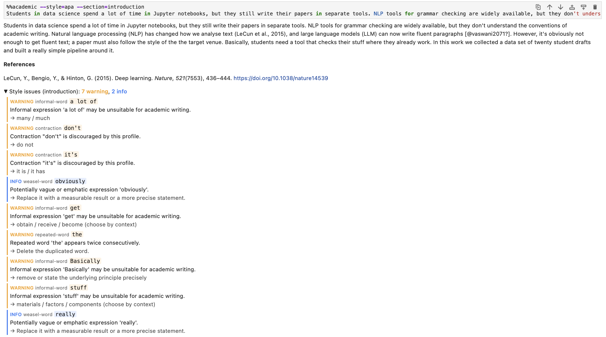
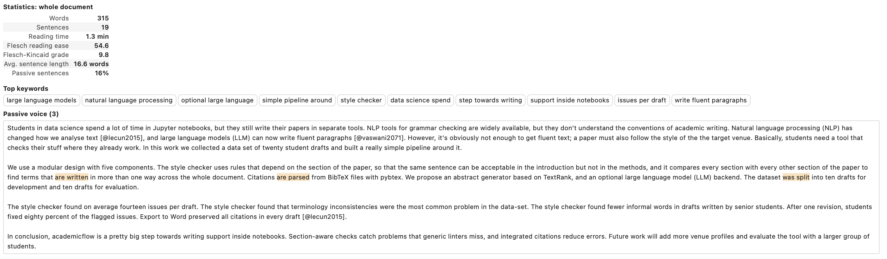
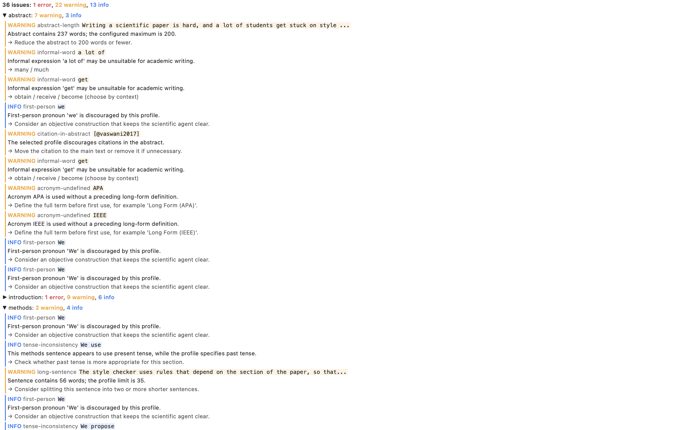

# Jupyter magics

`academicflow` adds six magics that turn a notebook into a paper-writing workspace. They keep
one shared **session** (venue profile, bibliography, sections, title, authors, abstract) and
call the other modules: `core`, `style`, `cite`, `summarize` and `export`.

```python
%load_ext academicflow
```

| Magic | What it does |
|-------|--------------|
| `%acite refs.bib` | Load a BibTeX file into the session |
| `%%academic` | Render, store and check one section |
| `%astats [section]` | Statistics table, keywords, highlighted passive voice |
| `%acheck` | Whole-document style check + citation integrity |
| `%aabstract [--words=200] [--llm]` | Generate and store the abstract |
| `%aexport paper.docx` | Export to DOCX, LaTeX or Markdown |

Every magic accepts `--debug`. Without it, errors appear as a short red message instead of a
traceback.

## `%acite`

```python
%acite refs.bib
# Loaded 12 references from refs.bib
```

## `%%academic`

```text
%%academic --style=apa --section=introduction
Transformers [@vaswani2017] changed machine translation.
```

Options:

- `--style=apa|ieee|nature` (or a path to a custom profile YAML) sets the venue profile for the
  whole session. It persists for later cells.
- `--section=NAME` names the section. Without it the cell is called `section-<n>`.
- `--no-check` hides the style-issue panel.
- `--title` marks the cell as the title block (see below).

The cell output shows the text with formatted citations, the references cited **in this cell**,
and a collapsible panel of style issues with severity colours. Re-running a cell with the same
`--section` replaces the section and keeps its position. Auto-named cells are matched by their
exact text, so give edited cells a `--section` name.

If the text has `[@key]` citations and no bibliography is loaded, a hint asks you to run
`%acite`.

Title and authors:

```text
%%academic --title
Effects of Sleep on Memory
Ada Lovelace
Alan Turing
```

The first line is the title, each further line is one author. `--authors="A; B"` also works.

!!! note
    Numbered styles (IEEE, Nature) number references per cell in the cell output. The exported
    document numbers them across the whole paper, by order of first appearance.

## `%astats`

`%astats introduction` shows the statistics for one section. `%astats` alone covers the whole
document (without the abstract). The output has word count, sentence count, reading time,
readability scores, average sentence length, passive ratio, top keywords and the text with
passive-voice phrases highlighted.

## `%acheck`

Runs `style.check_document` for the stored sections and `cite.check_integrity` for the full text.
Issues are grouped by section with counts per severity. Citation problems are assigned to the
section where the citation occurs. Problems without a position (for example an unused
bibliography entry) appear under **Document / bibliography**. A clean paper prints
"No issues found".

Switching `--style=apa` to `--style=nature` in a later `%%academic` cell changes which rules and
limits apply to the next `%acheck`.

## `%aabstract`

Builds the abstract from all sections except `abstract` and stores it as `session.abstract` and
as the `abstract` section. `--words` sets the maximum length. `--llm` uses the optional LLM
backend and falls back to the extractive summarizer when it is unavailable.

## `%aexport`

```python
%aexport paper.docx
%aexport paper.tex
%aexport notes.md --format=md
```

The format comes from the extension unless `--format` is given. The magic prints the absolute
path and shows a download link. See [Export](export.md).

## Session API

```python
from academicflow.magics.session import get_session, reset_session

session = get_session()
session.sections      # ordered dict: name -> markdown
reset_session()       # start a new paper
```

## Screenshots

### `%%academic`: formatted citations and style issues



### `%astats`: statistics, keywords and passive voice



### `%acheck`: issues grouped by section


